<picture>
  <source media="(prefers-color-scheme: dark)" srcset="assets/header-dark.svg">
  
</picture>

  <a href="https://math.lerno.dev/"><b>Try Lerno</b></a> ·
  <a href="https://www.loom.com/share/43a95f1915294d149420c87aafa09799"><b>Watch the demo</b></a> ·
  <a href="#vote-on-the-next-lerno-lesson"><b>Vote on a lesson</b></a> ·
  <a href="https://x.com/suryanshhhhh_p"><b>X</b></a>

## Now building: Lerno

Ask a maths question and watch it turn into a short animated lesson. Three scenes drawn in Manim, narration under the film, a quick check after every scene, and a tutor that knows exactly where you paused.

<picture>
  <source media="(prefers-color-scheme: dark)" srcset="assets/stats-dark.svg">
  
</picture>

<b>How a lesson gets made</b>

 

1. **Plan.** Claude Sonnet turns the question into three scenes: narration, an animation brief and a quiz for each.
2. **Write and render.** All three scenes run in parallel. Claude writes the Manim code, and each scene renders in its own Modal sandbox. A failed render goes back to Claude for a fix, up to two times.
3. **Store.** Videos go to Supabase Storage. Lessons, scenes and notes live in Postgres. The player gets short-lived signed links.
4. **Watch.** The React app polls until the lesson is ready. The tutor runs on Claude Haiku with the scene and the paused moment as context.

**Stack:** React 19 · Vite · Tailwind 4 · FastAPI · Modal · Supabase · Claude · Manim  
[Source](https://github.com/suryansh04/Lerno.ai)

## Other things I've shipped

  <a href="https://github.com/suryansh04/WaveWatch"><picture><source media="(prefers-color-scheme: dark)" srcset="assets/card-wavewatch-dark.svg"></picture></a>
  <a href="https://github.com/suryansh04/InternSetu"><picture><source media="(prefers-color-scheme: dark)" srcset="assets/card-internsetu-dark.svg"></picture></a>
  <a href="https://github.com/suryansh04/sunskip"><picture><source media="(prefers-color-scheme: dark)" srcset="assets/card-sunskip-dark.svg"></picture></a>
  <a href="https://github.com/suryansh04/GradeX"><picture><source media="(prefers-color-scheme: dark)" srcset="assets/card-gradex-dark.svg"></picture></a>

## Where I've worked

<picture>
  <source media="(prefers-color-scheme: dark)" srcset="assets/timeline-dark.svg">
  
</picture>

<b>Better (Jalan Technologies) · SDE intern · Jun to Sep 2026</b>

 

Worked on **Operate**, a self-hosted AI agent that finds the root cause of engineering incidents. 50+ merged PRs.

- Built the GitHub App auth flow: RS256-signed app JWTs swapped for 1-hour read-only installation tokens, HMAC-signed OAuth state, hashed install secrets checked in constant time, admin-only connect routes.
- Fixed GCP Cloud Logging, which was failing for every user.
- Shipped Dynatrace and SolarWinds integrations with alert webhooks, and a Sentry integration that opens cases on its own. Jenkins build history now links incidents to deploys.
- Owned the integrations UI in React and TypeScript.

<b>BillCut · Backend intern · Apr 2026, 2 months</b>

 

Built the Node.js and Express backend for **BillGPT**, BillCut's AI assistant for commerce and credit card rewards.

## Vote on the next Lerno lesson

Pick a topic. Your click opens a pre-filled issue. Hit **Submit**, and a GitHub Action counts the vote, redraws this chart and replies to you.

<picture>
  <source media="(prefers-color-scheme: dark)" srcset="assets/votes-dark.svg">
  
</picture>

  <a href="https://github.com/suryansh04/suryansh04/issues/new?title=vote%3A%20fourier%20series&body=Just%20hit%20Submit.%20Your%20vote%20is%20counted%20in%20about%20a%20minute."><b>fourier series</b></a> ·
  <a href="https://github.com/suryansh04/suryansh04/issues/new?title=vote%3A%20eigenvectors&body=Just%20hit%20Submit.%20Your%20vote%20is%20counted%20in%20about%20a%20minute."><b>eigenvectors</b></a> ·
  <a href="https://github.com/suryansh04/suryansh04/issues/new?title=vote%3A%20bayes%20theorem&body=Just%20hit%20Submit.%20Your%20vote%20is%20counted%20in%20about%20a%20minute."><b>bayes theorem</b></a> ·
  <a href="https://github.com/suryansh04/suryansh04/issues/new?title=vote%3A%20taylor%20series&body=Just%20hit%20Submit.%20Your%20vote%20is%20counted%20in%20about%20a%20minute."><b>taylor series</b></a> ·
  <a href="https://github.com/suryansh04/suryansh04/issues/new?title=vote%3A%20central%20limit%20theorem&body=Just%20hit%20Submit.%20Your%20vote%20is%20counted%20in%20about%20a%20minute."><b>central limit theorem</b></a>

## What I build with

<picture>
  <source media="(prefers-color-scheme: dark)" srcset="assets/stack-dark.svg">
  
</picture>

<picture>
  <source media="(prefers-color-scheme: dark)" srcset="https://raw.githubusercontent.com/suryansh04/suryansh04/output/snake-dark.svg">
  
</picture>

A maths topic that never clicked for you? <a href="https://math.lerno.dev/">Ask Lerno</a> and watch it explained.

