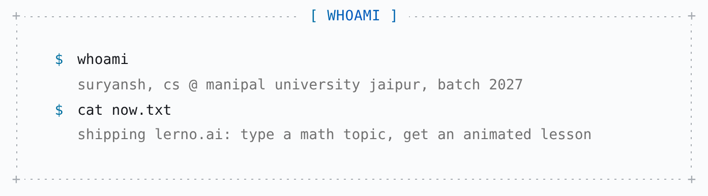
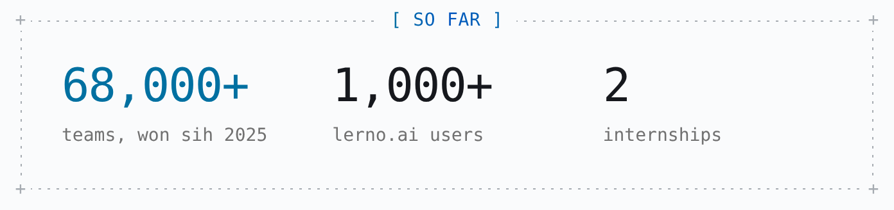
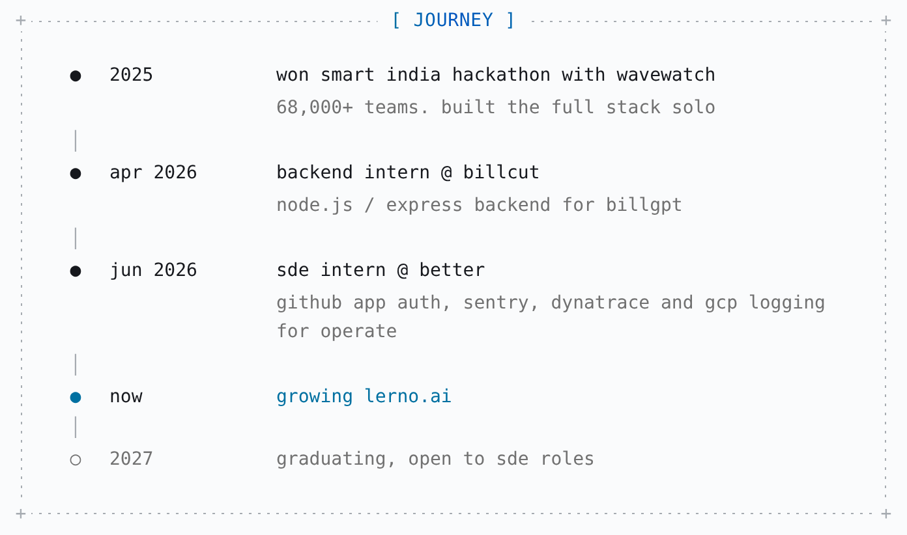
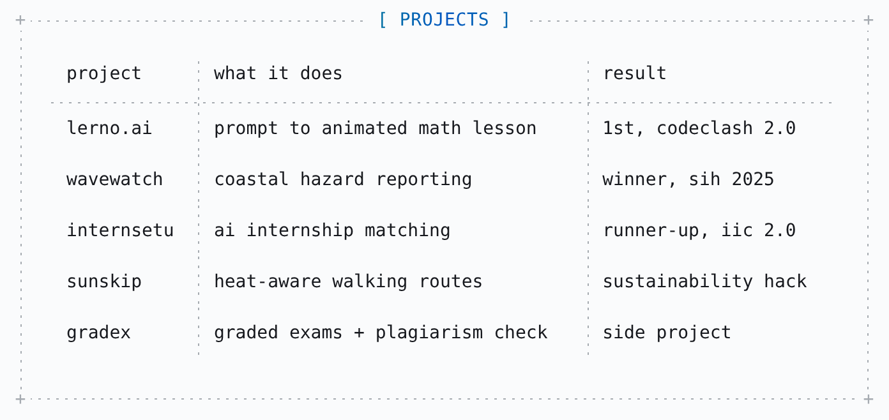
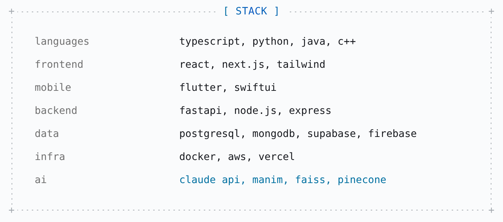

### Hey, I'm Suryansh 👋

I build full-stack AI products and ship them to real users.

<picture>
  <source media="(prefers-color-scheme: dark)" srcset="assets/whoami-dark.png">
  
</picture>

<picture>
  <source media="(prefers-color-scheme: dark)" srcset="assets/stats-dark.png">
  
</picture>

[Lerno.ai](https://math.lerno.dev/) is my main project. Try it, break it, tell me what broke. [Demo](https://www.loom.com/share/43a95f1915294d149420c87aafa09799)

<picture>
  <source media="(prefers-color-scheme: dark)" srcset="assets/journey-dark.png">
  
</picture>

<picture>
  <source media="(prefers-color-scheme: dark)" srcset="assets/projects-dark.png">
  
</picture>

**Repos:** [Lerno.ai](https://github.com/suryansh04/Lerno.ai) · [WaveWatch](https://github.com/suryansh04/WaveWatch) · [InternSetu](https://github.com/suryansh04/InternSetu) · [SunSkip](https://github.com/suryansh04/sunskip) · [GradeX](https://github.com/suryansh04/GradeX)

<picture>
  <source media="(prefers-color-scheme: dark)" srcset="assets/stack-dark.png">
  
</picture>

**Find me:** [X](https://x.com/suryanshhhhh_p)

Figures are <a href="https://www.mdxcn.dev">mdxcn</a> components.
